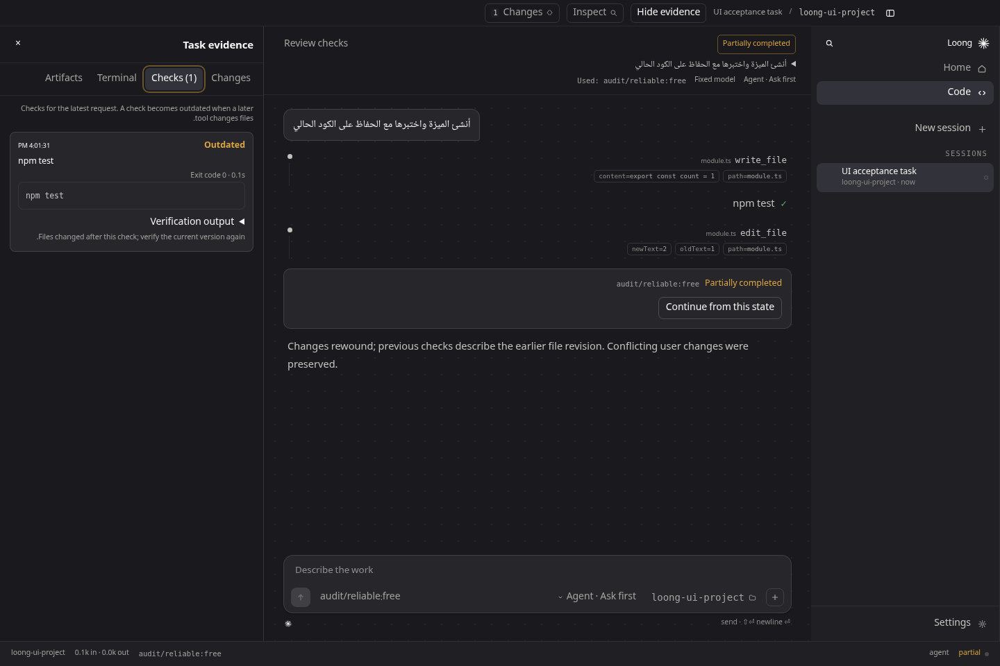

# Loong

A local desktop coding agent for working on real projects: inspect files, make changes, run commands, and review the evidence in one workspace.

[](https://github.com/alros2yhmh-commits/loong/actions/workflows/ci.yml)

**3.0 beta** · [العربية](docs/README.ar.md) · [Download releases](https://github.com/alros2yhmh-commits/loong/releases) · [Documentation](docs/README.md)

Loong keeps the selected project, model, permissions, changed files, and checks visible. It supports OpenRouter, Ollama, Anthropic, OpenAI, Google, and compatible endpoints. Model capability and availability affect what a task can achieve; a free endpoint is a supported option, not a guarantee of flagship-model performance or uninterrupted capacity.



*Interface acceptance-test fixture showing task status and check evidence; not a live model benchmark.*

## Start with the desktop app

If a release asset is available, download `Loong-<version>-Setup-x64.exe` from [GitHub Releases](https://github.com/alros2yhmh-commits/loong/releases), compare its SHA-256 against `SHA256SUMS.txt`, and run the installer. Windows x64 is the installer target. The installer does not require a system Node installation. Unsigned beta builds can trigger Windows SmartScreen; published checksums establish download integrity, not publisher identity.

For a source build, follow the steps below. CI artifacts on a successful build are also available under [Actions](https://github.com/alros2yhmh-commits/loong/actions); they are not the same as a published release.

1. Open a project folder in Loong.
2. Open **Settings → API keys** and configure your provider. Ollama instead needs its local service and a tool-capable model.
3. Pick a model. **Fixed** keeps your choice; **Auto** permits the documented compatible fallback policy. Free OpenRouter models stay within the free fallback pool.
4. Choose **Ask**, **Plan**, or **Agent**, and review the separate permission setting. **Ask first** requests approval before protected actions; **Full trust** permits supported operations within the selected workspace.
5. Send a concrete task. Review **Changes**, **Checks**, and **Terminal**. A partial, blocked, or failed task is distinct from a completed one. Review generated changes before committing or publishing them.

## Build a Windows Setup from source

Install [Git](https://git-scm.com/downloads) and [Node.js 24 LTS](https://nodejs.org/). Use a current Windows 10/11 x64 machine. If native dependency installation requires compilation, install Visual Studio 2022 Build Tools with **Desktop development with C++** and Python 3; restart the terminal afterward.

Run in PowerShell:

```powershell
git clone https://github.com/alros2yhmh-commits/loong.git
cd loong
node --version
npm ci
npm test
npm run build:exe
```

`node --version` should report `v24.x`. The installer is written to:

```text
app/Loong-3.0.0-beta.2-Setup-x64.exe
```

The version in the filename follows `package.json`. Run that installer, choose an installation folder, and launch **Loong** from the Start menu or desktop shortcut. You can also open `app/win-unpacked/Loong.exe` to check the unpacked build. Build on Windows for the Windows release; the Linux development environment does not establish Windows installer validation.

To update a clean source checkout later:

```powershell
git pull --ff-only
npm ci
npm run build:exe
```

Keep your own source changes committed or backed up before updating. [Full build instructions and troubleshooting](docs/development.md).

## Develop locally

```bash
npm ci
npm run dev
```

Open the Vite address printed in the terminal. The development UI uses port `5273` and proxies `/api` to the agent on `127.0.0.1:5274`. The native folder picker is available in the desktop shell; in browser development, set `LOONG_WORKSPACE` before starting the agent. For example, in PowerShell:

```powershell
$env:LOONG_WORKSPACE = (Get-Location).Path
npm run dev
```

To run the built desktop shell:

```bash
npm run build
npm run desktop
```

Do not run a second desktop instance to serve the same data store. The packaged app selects a private loopback port and supplies the renderer with a session token through its narrow Electron bridge.

## Useful commands

| Command | Purpose |
| --- | --- |
| `npm test` | Existing suites and regression tests; no live model key required |
| `npm run install:desktop` | Download/verify the pinned Electron runtime when needed |
| `npm run build` | Frontend/server type checks, renderer build, sidecar bundle |
| `npm run smoke:bundle` | Built API authentication/origin and native PTY smoke check |
| `npm run smoke:runtime` | Check built API/native PTY and restricted CodeAct under Electron's Node |
| `npm run smoke:desktop` | Real Electron renderer-to-sidecar smoke check; desktop display required |
| `npm run eval:list` | List the local evaluation tasks |
| `npm run eval:check` | Validate evaluation fixtures and their independent validators; no model score |
| `npm run build:exe` | Build Windows x64 NSIS installer on Windows |
| `npm run build:linux` | Build Linux x64 AppImage on Linux |
| `npm run checksums` | Write `app/SHA256SUMS.txt` for built release artifacts |

## Project and trust boundaries

Loong can read and modify a chosen project and execute approved commands with your OS account's permissions. Its workspace checks, command guards, renderer isolation, and approval controls are defense layers. They are **not a complete operating-system sandbox**. Use an isolated development account, VM, or container for untrusted repositories. Full trust does not make repository instructions or tool output trustworthy.

Provider keys are held by the agent and are not returned by the settings API. Desktop credentials use OS-keychain-backed encryption when available. Headless/keychain-unavailable fallback reports its plaintext storage mode explicitly; protect the application data directory and backups. Files sent to a model are governed by that provider's terms and routing settings. [Security model](SECURITY.md).

## Documentation

- [User guide](docs/user-guide.md): modes, models, approvals, evidence, and task outcomes.
- [Development](docs/development.md): Windows/Linux prerequisites and source workflow.
- [Architecture](docs/architecture.md): renderer, API, runtime, tools, context, and persistence.
- [Evaluation](docs/evaluation.md): reproducible fixtures, live runs, and honest scoring.
- [Validation evidence](docs/validation.md) and [implementation status](docs/roadmap.md).
- [Release process](docs/releasing.md): CI, installers, checksums, signing, and publication.
- [Troubleshooting](docs/troubleshooting.md): installation, provider, native terminal, and desktop problems.
- [Contributing](CONTRIBUTING.md) and [security reporting](SECURITY.md).

Created by **Professor Hamza Mahmoud Ramadan**. Third-party components retain their respective licenses. The generated `resources/agent/THIRD_PARTY_NOTICES.txt` and Electron/Chromium license notices accompany packaged builds.
