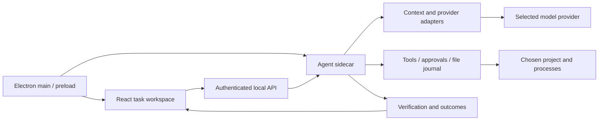

# Architecture

Loong is a local application with a React renderer and a separate agent process. The desktop shell owns the operating-system integration. The runtime owns tool execution and task outcomes. The UI presents those outcomes and evidence.

## Desktop boundary

`electron/main.cjs` starts a sidecar using Electron's own executable in `ELECTRON_RUN_AS_NODE` mode. It selects a private loopback port and supplies a fresh session token through the preload bridge. The bridge exposes configuration, a native directory picker, and HTTP(S) external links. IPC handlers validate the top-frame sender.

The renderer loads from the registered secure `loong://app` protocol, with context isolation, renderer sandboxing, and Node integration disabled. The protocol serves only packaged renderer assets. The API allows that exact origin and validates the session token for actual requests. An unauthenticated preflight is not an unauthenticated application request.

The CLI development server intentionally uses a separate browser workflow, normally ports 5273/5274. Do not expose the unsigned development API to an untrusted network.

## Runtime and models

- `server/agent.ts` manages the task, permissions, bounded continuation, provider retries, plans, and final outcome.
- `server/engine/kernel.ts` runs model/tool iterations, validates arguments, preserves the provider-compatible conversation, and batches independent reads.
- `server/providers.ts` and `server/catalog.ts` adapt providers and model metadata. Fixed model selection and Auto fallback are separate policies.
- `server/context.ts` assembles a bounded model-facing conversation while retaining the original requirements and recent work. This is a context-budget estimate, not an exact universal tokenizer.
- `server/cycle.ts` tracks observed reading, writing, and checks. Stage text must follow tool results rather than a stale prompt.
- `server/verify-gate.ts` describes bounded verification/repair. Required check output must reach the model before it can claim completion.

A model response ending with prose is not sufficient evidence that an implementation task is complete. Typed outcome data and actual changed files/checks drive the task result. Model-required reasoning metadata is protocol state, not evidence of correctness or a promise to expose private internal reasoning in the UI.

## Tools and state

File tools resolve paths inside a selected workspace and apply protected-path guards. Command and URL guards reduce accidental unsafe operations; shell execution still has the authority of the local OS account. Approvals are scoped to a live run. Journals record supported file changes and allow conflict-aware recovery; they cannot undo arbitrary external shell effects.

The durable run-state layer is separate from UI blocks: reconnecting must replay recorded observations rather than rerun tools. On process interruption, an external side effect with unknown result must be reconciled before retry. The app must not claim generic exactly-once command execution.

Legacy session/settings/history storage is JSON-based for bundled-runtime portability. Do not add runtime-specific persistence APIs without migration and packaged-app tests. Keep data migrations recoverable and leave user-owned edits intact.

## Renderer

`src/App.tsx` coordinates projects, tasks, mode/model controls, and the evidence panel. `src/lib/stream.ts` consumes runtime events; `src/lib/blocks.ts` builds renderable blocks. `EvidencePanel` groups Changes, Checks, Terminal, and artifacts. A disconnected transport is distinct from a successful task.

Directions are isolated so Arabic prose and left-to-right code/paths remain readable. Modal and approval interactions must retain keyboard navigation, focus management, and screen-reader status announcements.

## Supported and future capabilities

The current beta concentrates on reliable local execution, model routing, evidence, recovery, and reproducible packaging. Company-wide SSO/RBAC, a hosted multi-tenant service, full OS-level sandboxing, and measured parity with commercial agents are not established merely by this architecture or its unit tests. Treat them as separate engineering and evaluation work.
